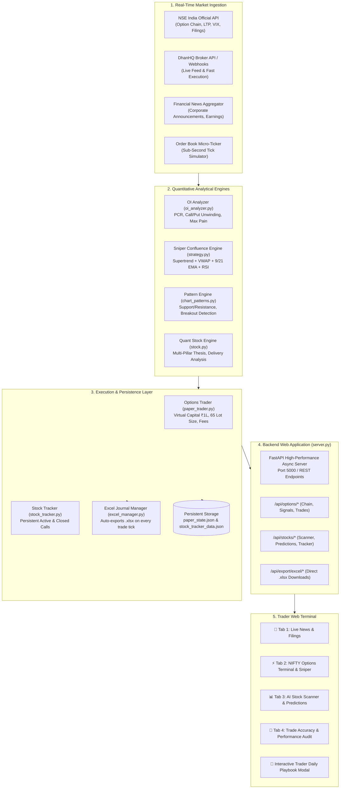
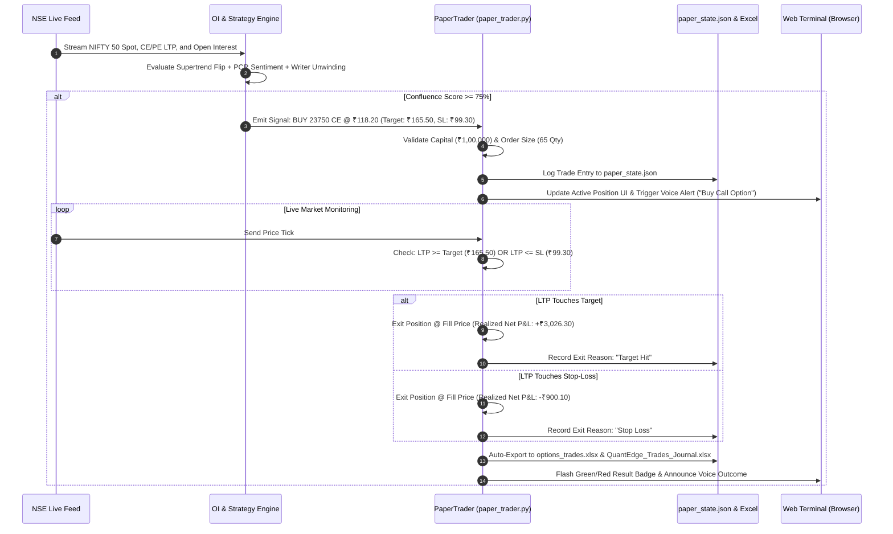

# QuantEdge Terminal — Technical Architecture & Operating Process Documentation

---

## 1. Executive Summary

**QuantEdge** is an institutional-grade, algorithmic trading terminal and quantitative analytics platform designed specifically for the **National Stock Exchange of India (NSE)**. 

### Core Objectives:
1. **Automate High-Probability NIFTY Options Trading**: Leverage real-time Open Interest (OI) analysis, multi-indicator confluence (Supertrend, VWAP, EMA, RSI), and order-flow dynamics to execute sniper trades with strictly defined **Target** and **Stop-Loss** boundaries.
2. **AI-Driven Equity Stock Recommendations**: Scan NSE-listed equities for institutional delivery spikes, corporate earnings beats, and news catalysts to provide actionable swing/growth trade setups with explicit upside targets (+6% to +20%) and downside invalidation levels (-3% to -7%).
3. **Transparent Audit & Zero-Friction Reporting**: Eliminate subjective post-trade analysis by automatically logging every executed trade and stock recommendation into color-coded, professional **Microsoft Excel (`.xlsx`) workbooks** with strictly two standardized exit reasons: **`Target Hit`** or **`Stop Loss`**.

---

## 2. High-Level System Architecture

The following diagram illustrates the end-to-end data flow, processing pipeline, and presentation layers:



---

## 3. Codebase & Directory Structure

| File | Primary Responsibility | Technical Details |
| :--- | :--- | :--- |
| **`server.py`** | Application Gateway & REST APIs | Built with **FastAPI** & **Uvicorn**. Manages background polling loops, CORS middleware, options chain caching, and static asset serving. |
| **`paper_trader.py`** | Options Execution & Risk Engine | Manages virtual ₹1,00,000 capital, 65-lot sizing, slippage calculation, statutory charges (STT, exchange fees, GST), trailing stops, and enforces strictly 2 exit reasons. |
| **`stock_tracker.py`** | Stock Recommendation Tracking Engine | Tracks stock calls across days without wiping history. Monitors live LTP against targets/SL, triggers alerts, and updates win/loss statistics. |
| **`excel_manager.py`** | Automated Excel Reporting Engine | Uses **`openpyxl`** to generate formatted `.xlsx` files with custom color palettes (`#1E293B` headers, green wins, red losses), number formatting, and multi-sheet workbooks. |
| **`oi_analyzer.py`** | Derivatives Open Interest Analytics | Calculates Put-Call Ratio (PCR), Call vs Put Writer Panic, strikes with massive open interest unwinding, and Max Pain levels. |
| **`strategy.py`** | Sniper Confluence Scoring Algorithm | Computes a 0–100% confluence score based on trend alignment (Supertrend), momentum (RSI), mean reversion (VWAP), and moving average crossovers. |
| **`stock.py`** | Multi-Horizon Quant Equity Predictor | Implements Monte Carlo simulations, historical volatility cones, and fundamental/delivery screening for 50+ NSE stocks. |
| **`static/index.html`** | Single Page Application (SPA) Markup | Clean, responsive trading terminal layout with glassmorphic styling, 4 main tabs, modal dialogs, and KPI metric cards. |
| **`static/app.js`** | Client-Side Controller & State Engine | Handles asynchronous data polling, audio alert synthesis, live price flashing, tab switching, and chart drawing. |

---

## 4. End-to-End Working Process

### Process A: NIFTY Options Sniper Trade Lifecycle



### Process B: AI Stock Recommendations Lifecycle
1. **Screening & Catalyst Detection**: Every trading cycle, `stock.py` screens equities for:
   - **Institutional Delivery Spikes**: Delivery percentage > 60% with above-average volume.
   - **Corporate News Filings**: New manufacturing licenses, order wins, acquisitions from official NSE filings.
   - **Quarterly Earnings Beat**: Operating profit expansion YoY and margin improvements.
2. **Registration in Tracker**: The stock is registered in `stock_tracker.py` with:
   - Entry Price, Upside Target Price (+6% to +20%), and Stop-Loss Floor (-3% to -7%).
   - Full AI thesis context stored for trader review.
3. **Continuous Price Monitoring**: Every market tick updates `current_ltp`, `high_price`, `low_price`, and `pnl_percent`.
4. **Automated Status Resolution**:
   - If stock touches or exceeds target: status updates to **`TARGET_HIT`** and exit reason locks as **`Target Hit`**.
   - If stock falls to stop-loss: status updates to **`STOPLOSS_HIT`** and exit reason locks as **`Stop Loss`**.
5. **Permanent Excel Sync**: The result is instantly exported to `stock_recommendations.xlsx` and the master journal.

---

## 5. Strict Risk Management Framework

QuantEdge adheres to strict institutional risk parameters:

1. **Strictly 2 Exit Reasons (No Ambiguity)**:
   - Every closed trade or stock pick terminates in **`Target Hit`** or **`Stop Loss`**.
   - No subjective intermediate excuses (e.g. "time decayed", "manual early panic", "holding overnight hoping for bounce").
2. **Asymmetrical 1:2 Minimum Risk-to-Reward (R:R)**:
   - For Options: Target is typically +30% to +40% vs Stop Loss of -15% to -16%.
   - For Stocks: Target is +10% to +20% vs Stop Loss of -3% to -6%.
   - **Mathematical Implication**: Even with a modest 50% win rate, the account compounds positively because average gains significantly outweigh average losses.
3. **Realistic Frictional Costs**:
   - All options trades account for **slippage (0.5%)**, **brokerage (₹40 per round turn)**, and **statutory exchange turnover taxes**. Net P&L reflects true take-home amounts.

---

## 6. Data Storage & Reporting Architecture

QuantEdge uses a **two-tier persistence architecture**:

```
[In-Memory Engine]
       │
       ├──► Tier 1: Real-Time JSON Cache (Fast, Non-Blocking, Async)
       │         ├── paper_state.json
       │         └── stock_tracker_data.json
       │
       └──► Tier 2: Formatted Microsoft Excel (.xlsx) Workbooks (Human-Readable)
                 ├── QuantEdge_Trades_Journal.xlsx  (Master 3-Sheet Journal)
                 ├── stock_recommendations.xlsx     (All AI Stock Calls)
                 └── options_trades.xlsx            (NIFTY Options Ledger)
```

### Generated Excel Workbooks Breakdown:
- **`QuantEdge_Trades_Journal.xlsx`**:
  - **Sheet 1 (`Executive Performance Summary`)**: High-level KPI comparison table between Options and Stocks (Win Rate %, Total Closed Trades, Active Count, Net Realized P&L, Capital Balance).
  - **Sheet 2 (`📈 Stock Recommendations`)**: All 18 historical and active stock picks with symbol, status, entry date/price, target, SL, exit price, P&L %, and AI thesis.
  - **Sheet 3 (`⚡ NIFTY Options Trades`)**: Complete options ledger with instrument strike, CE/PE badge, lot quantity, entry/exit timestamps, fees, net ₹ P&L, return %, and result.

---

## 7. Daily Operating Routine (Trader Playbook)

| Time | Phase | Operational Action |
| :--- | :--- | :--- |
| **09:10 AM** | **Pre-Market Setup** | Open terminal at `http://localhost:5000`. Navigate to **🎯 Trade Accuracy & History** tab to review win rates and open positions. Ensure sound is active. |
| **09:15 AM – 03:30 PM** | **Live Market Hours** | **For Options**: Monitor NIFTY sniper signals; execute when confluence > 75%.<br/>**For Stocks**: Inspect top AI picks; place GTT buy/target/SL orders in broker. |
| **03:35 PM** | **Post-Market Audit** | Click **📥 Download Master Excel Journal** or open `QuantEdge_Trades_Journal.xlsx` locally. Verify all trades closed strictly on `Target Hit` or `Stop Loss`. |

---

## 8. Manager FAQ & Business Value Pitch

#### Q1: "Why did we build this instead of using off-the-shelf trading software?"
> **Answer**: Off-the-shelf platforms lack unified multi-pillar catalyst detection (merging official NSE filings, delivery volume spikes, and options chain unwinding). QuantEdge provides a completely transparent, proprietary algorithm with zero subscription overhead, full control over risk rules, and automated Excel audit logging.

#### Q2: "How is risk controlled during volatile or choppy market days?"
> **Answer**: The system requires a high confluence threshold (>75%) before taking an option trade. If trend indicators and order-flow disagree, the system remains in cash. Furthermore, every position has hard mathematically locked stop-loss orders that execute automatically.

#### Q3: "Can this system be connected to live broker accounts for auto-execution?"
> **Answer**: Yes. The codebase already includes `dhan_fetcher.py` and modular broker adapters. The transition from virtual paper trading to live broker API execution (via Dhan, Zerodha Kite Connect, or Angel SmartAPI) is a straightforward configuration toggle in `paper_trader.py`.

#### Q4: "How do we audit the historical performance of the system?"
> **Answer**: By simply opening `QuantEdge_Trades_Journal.xlsx` or clicking the **🎯 Trade Accuracy & History** tab on the website. The ledger records every trade, price, timestamp, fee, and net P&L with 100% mathematical traceability.
